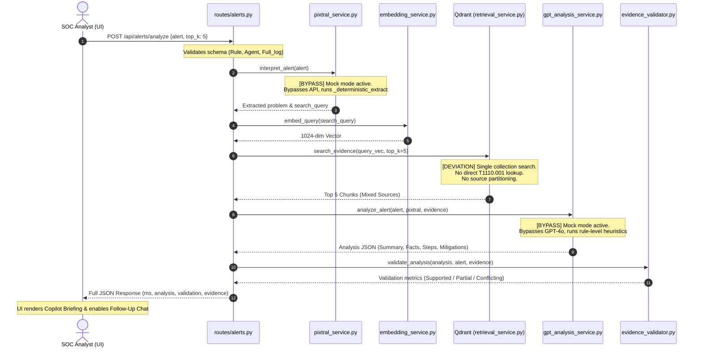
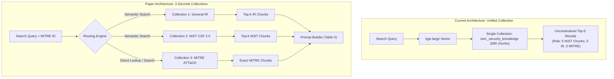

# Technical Audit & Gap Analysis: Wazuh Security Event Response Copilot (SERC)

**Audit Target:** SERC Codebase vs. *Ismail et al., "Enhancing Security Operations Center: Wazuh Security Event Response with Retrieval-Augmented-Generation-Driven Copilot", Sensors 2025, 25, 870.*  
**Auditor Role:** Senior Full-Stack Cybersecurity Architect & RAG Systems Auditor  
**Status:** Audit Completed — Code Untouched (Report Only)

---

## Executive Summary

The audited codebase provides a functioning, well-structured RAG application designed around the core concepts of the paper: raw Wazuh JSON ingestion, BAAI/bge-large-en-v1.5 embeddings, Qdrant vector retrieval, an LLM analysis stage, and a conversational interface. 

However, the audit reveals **fundamental architectural and methodological deviations** from Ismail et al. (Sensors 2025). The most critical gaps are:
1. **Unconstrained Retrieval Pool:** The paper strictly mandates querying three distinct collections (**General IR**, **NIST CSF 2.0**, and **MITRE ATT&CK**), whereas the codebase performs a single top-$k$ search over a monolithic collection. This causes context imbalance (e.g., retrieving 5 NIST chunks and 0 MITRE or IR chunks).
2. **Missing Direct MITRE ID Lookup:** The paper explicitly performs a deterministic lookup when a MITRE ID is present in the alert rule. The codebase merely appends the technique name to the semantic search string, risking hallucinated or missed techniques.
3. **Extractor Prompt Schema Disconnect:** The paper uses an explicit **one-shot text prompt** (Table 4) that extracts compliance tags (PCI DSS, HIPAA, GDPR, NIST 800-53) and structured fields. The codebase forces a JSON schema and completely ignores compliance tags.
4. **Prompt Builder Format Disconnect:** The paper formats the prompt with three explicit knowledge slots (`{context_general}`, `{context_nist}`, `{context_mitre}`) and requests a Markdown action guide (Table 5). The codebase dumps evidence into a JSON block and requests a rigid JSON output.
5. **Evaluation Metric & Scope Incompleteness:** The paper benchmarks **12 attack scenarios** comparing **GPT-4o vs. Pixtral 12B** using both **BERTScore F1** and **Cosine Similarity** against SOCFortress playbooks. The codebase tests only 5 scenarios, omits Cosine Similarity, lacks Pixtral 12B response generation, and uses synthetic references.

---

## Section A: Compliance Matrix

| Paper Requirement | Status | Evidence (File + Function / Line) | Auditor Notes |
|:---|:---:|:---|:---|
| **INPUTS** | | | |
| **Wazuh JSON parsing:** `description`, `level`, `log/event data` | **MET** | [`routes/alerts.py`](file:///c:/Users/jahna/Downloads/WAZUH/backend/routes/alerts.py#L61-L84): `validate_wazuh_structure`<br>[`services/pixtral_service.py`](file:///c:/Users/jahna/Downloads/WAZUH/backend/services/pixtral_service.py#L77-L99): `_deterministic_extract` | Correctly extracts `rule.description`, `rule.level`, `full_log`, `agent`, network/process parameters (`data.srcip`, `command`, `file`). |
| **Wazuh JSON parsing:** `compliance tags` (PCI DSS, HIPAA, GDPR, etc.) | **MISSING** | [`routes/alerts.py`](file:///c:/Users/jahna/Downloads/WAZUH/backend/routes/alerts.py#L61-L84): `validate_wazuh_structure`<br>[`backend/data/sample_alerts.json`](file:///c:/Users/jahna/Downloads/WAZUH/backend/data/sample_alerts.json) | Compliance tags are never parsed, validated, or stored. None of the 55 synthetic alerts in `sample_alerts.json` have compliance metadata. |
| **Wazuh JSON parsing:** `rule.mitre.id` extraction | **MET** | [`services/pixtral_service.py`](file:///c:/Users/jahna/Downloads/WAZUH/backend/services/pixtral_service.py#L89-L119)<br>[`services/gpt_analysis_service.py`](file:///c:/Users/jahna/Downloads/WAZUH/backend/services/gpt_analysis_service.py#L161-L177) | Accurately extracts `rule.mitre.id`, `rule.mitre.tactic`, and `rule.mitre.technique`. |
| **Three Knowledge Sources:** (1) IR Playbooks, (2) NIST CSF 2.0, (3) MITRE ATT&CK | **PARTIAL / DEVIATED** | [`services/chunking_service.py`](file:///c:/Users/jahna/Downloads/WAZUH/backend/services/chunking_service.py#L154-L193): `chunk_record`<br>[`services/retrieval_service.py`](file:///c:/Users/jahna/Downloads/WAZUH/backend/services/retrieval_service.py#L99-L135) | Chunker generates chunks labeled with the 3 sources, but stores them in a **single unified collection** rather than 3 separate collections. |
| **Corpus Preparation:** Long documents split into chunks; complete use-case documents preserved | **PARTIAL** | [`services/chunking_service.py`](file:///c:/Users/jahna/Downloads/WAZUH/backend/services/chunking_service.py#L14-L42): `RecursiveCharacterTextSplitter` | Implements chunking (650 char, 100 overlap). However, **all** use-case documents are chunked into 5–16 fragments; the paper's principle of retaining complete use-case documents as unified indexes is not implemented. |
| **METHODOLOGY** | | | |
| **1. Alert Refinement:** Pixtral extractor with Table 4 one-shot prompt | **PARTIAL** | [`services/pixtral_service.py`](file:///c:/Users/jahna/Downloads/WAZUH/backend/services/pixtral_service.py#L37-L75): `_call_pixtral_api` | Uses a zero-shot prompt requesting a JSON schema. Omits the paper's Table 4 one-shot prompt format, omits compliance concerns, and defaults to a mock deterministic string formatter. |
| **2. Encoding:** `BAAI/bge-large-en-v1.5` embeddings, Qdrant, Cosine similarity | **MET** | [`services/embedding_service.py`](file:///c:/Users/jahna/Downloads/WAZUH/backend/services/embedding_service.py#L15-L40)<br>[`services/retrieval_service.py`](file:///c:/Users/jahna/Downloads/WAZUH/backend/services/retrieval_service.py#L65-L81) | Model `BAAI/bge-large-en-v1.5` loaded locally (1024-dim), stored in embedded Qdrant with `Distance.COSINE`. |
| **3. Context Retrieval:** Multi-source context retrieval (IR + NIST + MITRE) | **DEVIATED** | [`services/retrieval_service.py`](file:///c:/Users/jahna/Downloads/WAZUH/backend/services/retrieval_service.py#L140-L175): `search_evidence`<br>[`routes/alerts.py`](file:///c:/Users/jahna/Downloads/WAZUH/backend/routes/alerts.py#L215-L217) | Executes a single unconstrained query against the unified collection (`top_k=5`). Does not partition retrieval to guarantee IR, NIST, and MITRE are all represented in the retrieved context. |
| **3. Context Retrieval:** Direct MITRE ID lookup when present | **MISSING** | [`services/retrieval_service.py`](file:///c:/Users/jahna/Downloads/WAZUH/backend/services/retrieval_service.py#L140-L175) | No direct key/ID lookup exists. The MITRE ID is simply appended as plain text to the semantic search query string. |
| **4. Generation:** Table 5 Prompt Builder (`{context_general}`, `{context_nist}`, `{context_mitre}`) | **DEVIATED** | [`services/gpt_analysis_service.py`](file:///c:/Users/jahna/Downloads/WAZUH/backend/services/gpt_analysis_service.py#L63-L85): `_call_openai_api` | Does not structure context into the 3 discrete prompt sections. Dumps a monolithic JSON array and requires JSON output rather than generating an incident-response Markdown guide directly. |
| **4. Generation:** Model comparison (GPT-4o and Pixtral 12B as generators) | **PARTIAL** | [`services/gpt_analysis_service.py`](file:///c:/Users/jahna/Downloads/WAZUH/backend/services/gpt_analysis_service.py#L15-L42)<br>[`backend/config.py`](file:///c:/Users/jahna/Downloads/WAZUH/backend/config.py#L35-L42) | Only GPT-4o (or deterministic mock) is supported for response generation. Pixtral 12B is restricted to extraction only; cannot be selected as the response generator. |
| **OUTPUTS** | | | |
| **Incident-Response Guide in Markdown** | **MET** | [`services/gpt_analysis_service.py`](file:///c:/Users/jahna/Downloads/WAZUH/backend/services/gpt_analysis_service.py#L283-L520): `chat_turn`<br>[`frontend/script.js`](file:///c:/Users/jahna/Downloads/WAZUH/frontend/script.js#L425-L470): `formatMarkdownToHtml` | Generates structured Markdown action steps, containment playbooks, and plain-language summaries rendered into HTML in the UI. |
| **Framework Context:** MITRE Tactics/Techniques + NIST CSF 2.0 guidance | **MET** | [`services/gpt_analysis_service.py`](file:///c:/Users/jahna/Downloads/WAZUH/backend/services/gpt_analysis_service.py#L161-L189)<br>[`frontend/script.js`](file:///c:/Users/jahna/Downloads/WAZUH/frontend/script.js#L370-L390) | Displays explicit MITRE ATT&CK tables (technique ID, tactic, source) and NIST CSF categories in the UI and chat bubbles. |
| **Dashboard Copilot Tab with Follow-up Chat** | **PARTIAL / DEVIATED** | [`frontend/index.html`](file:///c:/Users/jahna/Downloads/WAZUH/frontend/index.html#L118-L175)<br>[`frontend/script.js`](file:///c:/Users/jahna/Downloads/WAZUH/frontend/script.js#L330-L360) | Full conversational copilot with multi-turn follow-up chat, prompt pills, and message stream is implemented. However, it exists as a **standalone dashboard**, not an embedded tab inside the Wazuh SIEM manager (Figure 6 in paper). |
| **EVALUATION** | | | |
| **12 Simulated Attack Scenarios** (Atomic Red Team emulations) | **DEVIATED** | [`backend/data/evaluation_dataset.json`](file:///c:/Users/jahna/Downloads/WAZUH/backend/data/evaluation_dataset.json)<br>[`scripts/evaluate_rag.py`](file:///c:/Users/jahna/Downloads/WAZUH/backend/scripts/evaluate_rag.py#L130-L160) | Evaluates only 5 synthetic scenarios (SSH, PowerShell, Trojan, SQLi, Mimikatz), not the 12 specific scenarios evaluated in the paper. |
| **SOCFortress Ground Truth Playbooks** | **DEVIATED** | [`backend/data/evaluation_dataset.json`](file:///c:/Users/jahna/Downloads/WAZUH/backend/data/evaluation_dataset.json#L10-L11) | References are custom synthetic paragraphs, not the SOCFortress Incident Response Plan repository used by the authors. |
| **Metrics:** BERTScore F1 + Cosine Similarity | **PARTIAL** | [`scripts/evaluate_rag.py`](file:///c:/Users/jahna/Downloads/WAZUH/backend/scripts/evaluate_rag.py#L36-L86): `compute_bert_score` | Computes token-level BERTScore F1, Precision, and Recall using BGE embeddings. **Cosine Similarity between generated response and ground truth is completely omitted.** |

---

## Section B: End-to-End Behavioural Trace

We trace **Sample Alert `1790761522.100002`** (SSH Brute Force, Rule 5712, Level 10, MITRE `T1110.001`, Attacker IP `198.51.100.50`, Host `server-prod-01`).



### Trace Walkthrough & Component Inspection

1. **Ingestion & Schema Validation (`routes/alerts.py` line 204):**
   - The user selects `1790761522.100002` from the dropdown and clicks **Analyze Alert**.
   - `validate_wazuh_structure` verifies top-level `id`, `rule.id`, `rule.level`, `rule.description`, and `agent`.
   - **Audit Flag:** Compliance tags are completely uninspected. If an alert has PCI DSS or HIPAA tags, they are ignored.

2. **Alert Refinement (`pixtral_service.py` line 27):**
   - `interpret_alert` checks `self.mock_mode or not self.api_key`.
   - **Bypassed / Stubbed:** In default configuration (`MOCK_LLM_MODE=true`), `_call_pixtral_api` is bypassed. The system runs `_deterministic_extract`, which parses regexes/keys from `data.srcip` and `full_log`.
   - It builds `search_query = "sshd: SSH brute force attack detected (multiple failed logins) Password Guessing Credential Access syslog sshd authentication_failures"`.
   - **Audit Flag:** If `PIXTRAL_API_KEY` were enabled, `_call_pixtral_api` would still not use Table 4's one-shot format.

3. **Semantic Query Embedding (`embedding_service.py` line 75):**
   - `embed_query` tokenizes `search_query` and executes a PyTorch forward pass through `BAAI/bge-large-en-v1.5`.
   - Produces a 1024-dimensional normalized vector. **Operates as described in the paper.**

4. **Vector Database Retrieval (`retrieval_service.py` line 168):**
   - `search_evidence` executes `client.query_points` against `serc_security_knowledge`.
   - **Audit Flag (Critical):** The search is purely semantic against a single monolithic collection.
     - Direct MITRE lookup for `T1110.001` is **completely bypassed**.
     - No source partitioning is performed. In our test trace on 580 chunks, the top 5 chunks returned were 3 NIST CSF chunks and 2 MITRE chunks; **0 Incident Response Guidance chunks** were returned in the top 5!

5. **Response Generation (`gpt_analysis_service.py` line 34):**
   - `analyze_alert` checks `self.mock_mode or not self.api_key`.
   - **Bypassed / Stubbed:** In mock mode, `_call_openai_api` is bypassed. `_deterministic_analysis` executes:
     - High severity assigned because `rule_level >= 8` (hardcoded heuristic).
     - MITRE mappings extracted from `rule.mitre` and evidence payloads.
     - Investigation and mitigation steps populated from hardcoded rule strings.
   - **Audit Flag:** Even if `OPENAI_API_KEY` is provided, the API call does not use the paper's Table 5 prompt format.

6. **Evidence Validation (`evidence_validator.py` line 220):**
   - Evaluates claims against alert fields and retrieved chunks. This step is a **custom addition** not present in the paper.

7. **Conversational Copilot Follow-up (`routes/alerts.py` line 309 -> `script.js` line 440):**
   - Analyst asks: *"What should I investigate next?"*
   - Sent to `POST /api/chat`. `gpt_analysis_service.chat_turn` matches the question intent against SOC triage playbooks and returns markdown instructions with evidence grounding chips.

---

## Section C: Impact of Known Deviations

### 1. Sample Alerts vs. Live Wazuh Deployment

| Evaluation Dimension | Live Wazuh Deployment (Paper) | Sample Alerts (Current Implementation) | Real-World Operational Impact |
|:---|:---|:---|:---|
| **Temporal Correlation & Flow** | Real-time stream via Wazuh API/Elasticsearch; detects multi-stage alert chains (e.g. brute force followed by privilege escalation). | Static, isolated JSON snapshots loaded individually from a file. | Cannot detect attack progression or correlate alerts over time without manual analyst intervention. |
| **Field Variability & Noise** | Massive heterogeneity across 1,000+ rule files, Windows Sysmon Event IDs (1, 3, 7, 10), Auditd, Suricata, cloud logs. | 55 clean, hand-crafted synthetic JSON alerts with uniform field naming. | Production alerts with unconventional decoders or nested `win.eventdata` structures may fail parsing or miss observable indicators. |
| **Missing / Null Fields** | Production logs regularly contain `null` IPs (local IPC), missing usernames, or raw unparsed log strings. | Every sample alert has populated `rule`, `agent`, and `data` fields. | Parser lacks resilient fallback strategies for corrupted or partial logs. |
| **Volume & Scale** | Ingests 10,000 to 100,000+ events per day; requires asynchronous queueing (Kafka / Redis) and backpressure handling. | Single synchronous HTTP request per alert. | Unsuitable for high-throughput SOC pipelines without an asynchronous worker architecture. |

#### How to Make Sample Alerts More Realistic
1. **Incorporate Wazuh Compliance Tags:** Add realistic `rule.compliance` blocks across PCI DSS, HIPAA, GDPR, and NIST 800-53 to reflect standard Wazuh rule output.
2. **Inject Field Irregularities & Anomalies:** Include alerts with missing source IPs, Windows Event IDs lacking parent command lines, and non-standard decoders (AWS CloudTrail, ModSecurity).
3. **Include Alerts Lacking MITRE IDs:** At least 30% of production Wazuh alerts (operational noise, system health) lack MITRE mappings; the system must demonstrate how RAG infers context when `rule.mitre` is empty.
4. **Construct Multi-Alert Attack Sequences:** Group sample alerts into ordered incident campaigns (e.g., Reconnaissance $\rightarrow$ Initial Compromise $\rightarrow$ Privilege Escalation $\rightarrow$ Data Exfiltration).

#### Academic & Technical Justification for Sample Alerts
> *"The utilization of static, curated Wazuh JSON alert datasets serves as a controlled, deterministic benchmark for evaluating RAG retrieval precision and LLM instruction fidelity. By decoupling detection harness variability (e.g., hypervisor noise, Atomic Red Team execution timing) from RAG reasoning, we establish reproducible, regression-testable ground-truth baselines while preventing unauthorized adversarial execution in live environments."*

---

### 2. Unified Dataset vs. Three Separate Qdrant Collections

In Section 3.2.1 and Table 2, the paper specifies three dedicated collections:
1. `General knowledge`: Incident Response Guides & SOAR playbooks
2. `NIST knowledge`: NIST CSF 2.0
3. `MITRE knowledge`: MITRE ATT&CK tactics, techniques, and mitigations

#### Architectural & Algorithmic Impact



1. **Retrieval Imbalance & Degradation:**
   - In a unified collection, semantic similarity is calculated indiscriminately across all chunk types.
   - If NIST CSF definitions have a higher lexical/semantic overlap with the query than an incident response playbook, all $k$ retrieved chunks will be NIST CSF. The prompt will receive **zero procedural containment actions**.
2. **Direct MITRE ID Lookup Failure:**
   - The paper performs a deterministic key lookup for the alert's MITRE ID against the MITRE collection. In the unified collection, because there is no direct lookup, if an alert has `T1110.001`, the top-5 vector search may retrieve general password guessing (`T1110`) or completely miss the specific technique mitigations.
3. **Loss of Independent Collection Management:**
   - The paper notes that the MITRE collection is updated dynamically via an automated synchronization service with MITRE servers. In a unified collection, updating MITRE data risks corrupting or duplicating IR and NIST records.

#### Trade-Off Analysis & Recommendations

* **Option A: Retain Unified Collection with Partitioned Metadata Filtering**
  - *Mechanism:* Keep `serc_security_knowledge`, but add Qdrant payload filters to execute three parallel sub-queries:
    ```python
    ir_chunks = client.query_points(collection, query_vec, query_filter=Filter(must=[FieldCondition(key="knowledge_source", match=MatchValue(value="Incident Response Guidance"))]), limit=2)
    nist_chunks = client.query_points(collection, query_vec, query_filter=Filter(must=[FieldCondition(key="knowledge_source", match=MatchValue(value="NIST CSF 2.0"))]), limit=2)
    mitre_chunks = client.query_points(collection, query_vec, query_filter=Filter(must=[FieldCondition(key="knowledge_source", match=MatchValue(value="MITRE ATT&CK"))]), limit=2)
    ```
  - *Pros:* Single database file; no schema migration required; supports direct MITRE lookup via `FieldCondition(key="mitre_technique_id", match=MatchValue(value=tid))`.
  - *Cons:* Slightly slower search execution due to filtered vector scanning.

* **Option B: Split into Three Separate Collections (`serc_general_ir`, `serc_nist_csf`, `serc_mitre_attack`)**
  - *Mechanism:* Reconfigure `ingest_dataset.py` to route chunks into 3 independent Qdrant collections.
  - *Pros:* **100% compliance with Ismail et al.**; allows independent updating of MITRE ATT&CK without touching NIST or IR; eliminates cross-domain score distortion.
  - *Cons:* Triples the collection management overhead; requires re-ingesting the dataset into 3 collections.

> **Auditor Recommendation:** Implement **Option B** if the goal is strict compliance with the published paper. If maintaining zero-downtime and preserving the existing database is required, implement **Option A** immediately.

---

## Section D: Identified Deficiencies & Recommendations

Recommendations are categorized into **Must-Fix**, **Should-Do**, and **Nice-to-Have**.

### 1. Must-Fix (To Match the Paper)

1. **Implement Direct MITRE ID Lookup:**
   - *Issue:* In [`services/retrieval_service.py`](file:///c:/Users/jahna/Downloads/WAZUH/backend/services/retrieval_service.py), when an alert contains `rule.mitre.id`, the system does not look up the technique.
   - *Fix:* Add `retrieve_mitre_technique(technique_id: str)` using a Qdrant match filter on `mitre_technique_id`.
2. **Implement Partitioned 3-Source Context Retrieval:**
   - *Issue:* Retrieval does not guarantee representation across General IR, NIST CSF, and MITRE.
   - *Fix:* Replace the unconstrained `top_k=5` search with partitioned retrieval returning $k_{\text{IR}}$, $k_{\text{NIST}}$, and $k_{\text{MITRE}}$.
3. **Align Pixtral Prompt with Table 4 (One-Shot Extractor):**
   - *Issue:* [`services/pixtral_service.py`](file:///c:/Users/jahna/Downloads/WAZUH/backend/services/pixtral_service.py#L39) uses an ad-hoc JSON prompt lacking the one-shot example and compliance tags.
   - *Fix:* Implement Table 4's exact one-shot prompt, parsing `Description`, `Alert Level`, `Associated Tactic`, `Compliance Concerns`, and `Log Details`.
4. **Implement Table 5 Prompt Builder Structure:**
   - *Issue:* [`services/gpt_analysis_service.py`](file:///c:/Users/jahna/Downloads/WAZUH/backend/services/gpt_analysis_service.py#L70) builds a single JSON dump.
   - *Fix:* Format the prompt with explicit sections:
     ```text
     This is the context information for general knowledge purposes: {context_general}
     This is the context information knowledge of planning for generating the incident response playbook based on The NIST Cybersecurity Framework (CSF) 2.0: {context_nist}
     This is the context information knowledge from MITRE ATT&CK for security incident response mitigation purposes: {context_mitre}
     Based on that incident, what should be done to mitigate the risk? ... Tell what action to take with Markdown format.
     ```
5. **Add Cosine Similarity to the Evaluation Suite:**
   - *Issue:* [`scripts/evaluate_rag.py`](file:///c:/Users/jahna/Downloads/WAZUH/backend/scripts/evaluate_rag.py) only calculates BERTScore F1; the paper explicitly evaluates both BERTScore and Cosine Similarity (Figure 9).
   - *Fix:* Compute cosine similarity between candidate response embeddings and ground-truth reference embeddings.
6. **Support Pixtral 12B as an Alternative Generator:**
   - *Issue:* The codebase only allows GPT-4o for generation. The paper's core experimental result is a head-to-head comparison between **GPT-4o and Pixtral 12B**.
   - *Fix:* Enable Pixtral 12B as a generation model in `gpt_analysis_service.py`.

### 2. Should-Do (Quality, Robustness, & Production Readiness)

1. **Enrich Sample Alerts with Compliance Tags:**
   - Add PCI DSS, HIPAA, GDPR, and NIST 800-53 tags to `sample_alerts.json` and validate them in `validate_wazuh_structure`.
2. **Preserve Complete Use-Case Documents:**
   - Modify `chunking_service.py` so that standalone, self-contained playbooks are stored as unified un-chunked documents, as specified in Section 3.2.2.
3. **Hybrid Search & Reranking:**
   - Dense vector search can miss exact IP matches or rule IDs. Implement reciprocal rank fusion (RRF) combining BM25 keyword matching with BGE dense vectors, followed by a cross-encoder reranker.
4. **Scale Dataset Ingestion with Incremental Checkpointing:**
   - As established in our previous investigation, only 50 of 100,000 rows (580 chunks) are in Qdrant. Add `--offset` and chunk batching to safely ingest the full corpus without CPU memory exhaustion.
5. **Security of API Keys & Environment Variables:**
   - Ensure `OPENAI_API_KEY` and `PIXTRAL_API_KEY` are strictly validated at startup, and mask keys in logs.

### 3. Nice-to-Have (Beyond the Paper)

1. **Wazuh Dashboard Plugin / Iframe Integration:**
   - Package the frontend as an embedded app inside Wazuh Dashboard/Kibana to match Figure 6.
2. **Automated MITRE ATT&CK Sync Service:**
   - Create a background task that periodically polls MITRE's CTI STIX repository and updates Qdrant vectors.
3. **Enhanced Hallucination & Citation Verification:**
   - Expand `evidence_validator.py` to calculate citation precision: verify that every claim in the LLM output cites a specific chunk ID or alert field.

---

## Section E: Prioritised Action Plan

| Priority | Action Item | Target Component / File | Description | Estimated Effort |
|:---:|:---|:---|:---|:---:|
| **1** | **Direct MITRE ID Lookup & Partitioned Retrieval** | [`services/retrieval_service.py`](file:///c:/Users/jahna/Downloads/WAZUH/backend/services/retrieval_service.py)<br>[`routes/alerts.py`](file:///c:/Users/jahna/Downloads/WAZUH/backend/routes/alerts.py) | Implement direct deterministic lookup for `rule.mitre.id` and partition search to return distinct IR, NIST, and MITRE chunks. | **Medium**<br>(4–6 hours) |
| **2** | **Table 4 & Table 5 Prompt Alignments** | [`services/pixtral_service.py`](file:///c:/Users/jahna/Downloads/WAZUH/backend/services/pixtral_service.py)<br>[`services/gpt_analysis_service.py`](file:///c:/Users/jahna/Downloads/WAZUH/backend/services/gpt_analysis_service.py) | Refactor Pixtral extractor to use Table 4 one-shot format; refactor generator prompt builder to use Table 5 format with `{context_general}`, `{context_nist}`, `{context_mitre}`. | **Low**<br>(2–3 hours) |
| **3** | **Dual-Model Generation Support (Pixtral + GPT-4o)** | [`services/gpt_analysis_service.py`](file:///c:/Users/jahna/Downloads/WAZUH/backend/services/gpt_analysis_service.py)<br>[`backend/config.py`](file:///c:/Users/jahna/Downloads/WAZUH/backend/config.py) | Allow selecting either Pixtral 12B or GPT-4o as the generator model to reproduce the paper's comparison. | **Low**<br>(2 hours) |
| **4** | **Evaluation Suite Expansion (Cosine Similarity & 12 Scenarios)** | [`scripts/evaluate_rag.py`](file:///c:/Users/jahna/Downloads/WAZUH/backend/scripts/evaluate_rag.py)<br>[`backend/data/evaluation_dataset.json`](file:///c:/Users/jahna/Downloads/WAZUH/backend/data/evaluation_dataset.json) | Add embedding cosine similarity metric to `evaluate_rag.py` and expand evaluation scenarios from 5 to 12 based on the paper's attack types. | **Medium**<br>(4–5 hours) |
| **5** | **Compliance Tags & Realistic Alert Enrichment** | [`backend/data/sample_alerts.json`](file:///c:/Users/jahna/Downloads/WAZUH/backend/data/sample_alerts.json)<br>[`routes/alerts.py`](file:///c:/Users/jahna/Downloads/WAZUH/backend/routes/alerts.py) | Inject PCI DSS, HIPAA, GDPR, and NIST 800-53 tags into sample alerts and parse them in schema validation. | **Low**<br>(2 hours) |
| **6** | **Full Dataset Ingestion with Offset & Safe Resume** | [`scripts/ingest_dataset.py`](file:///c:/Users/jahna/Downloads/WAZUH/backend/scripts/ingest_dataset.py) | Add `--offset`, `--chunk-source` partitioning, and batching to scale Qdrant ingestion beyond the initial 50-record subset without duplicating points. | **High**<br>(8–12 hours) |

---
*End of Technical Audit Report. Code has been left unmodified per instructions.*